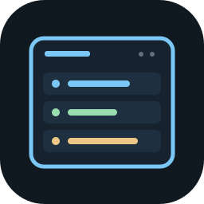

# Seshat

A self-hosted dashboard for GitHub project health and open pull requests,
intended to run on Cloudflare's free tier. Named after Seshat, the Egyptian
goddess of writing and record keeping.

Seshat is starting to build its first deliverable, the PR overview defined in
[DELIVERABLE.md](docs/DELIVERABLE.md), on the stack chosen in
[DECISIONS.md](docs/DECISIONS.md#2026-10-13--cloudflare-stack). So far there
is a Cloudflare Worker with its Durable Object, owner-only sign-in through
the instance's own GitHub App, the setup pages that register and install
that App, and a placeholder React page. The rules that sort open PRs into
the overview's buckets are written and tested in `src/shared/overview/`,
but nothing feeds them from GitHub yet. The owner-only snapshot at
`/api/overview` and hibernating WebSocket at `/api/overview/socket` expose
stored overview data with those rules already applied. The socket requires
the owner's session and a matching Origin, sends a snapshot on connect,
answers `ping` with `pong`, and retains visibility reports across hibernation.
Nothing is deployed.

The intended dashboard connects to GitHub, lets the instance owner monitor
selected repositories, groups projects by their state, and shows open pull
requests that need attention. Only the owner may sign in; a public view is an
optional future capability.

The project also aims to replace a manually maintained `PROJECTS.md` index.
Its [format](docs/INDEX_FORMAT.md) and
[classifications](docs/specs/2026-10-15-project-classifications.md) are
defined, and an optional agent skill,
[survey-projects](skills/survey-projects/README.md), surveys local checkouts
and updates it. See the [project brief](docs/BRIEF.md) for requirements and
design questions.

The local [Seshat CLI](docs/CLI.md) lists index entries by classification,
runs commands across their paths, checks the format and disk coverage, and
surveys local Git signals. Run `./bin/seshat --help` after setup; it needs
no hosted instance or credential and shares the survey skill's settings.

## Development workflow

Read [AGENTS.md](AGENTS.md) and the [Docket contract](docket/CONTRACT.md).
Git, Bash and Node.js (the major version in `.node-version` or later, with its
bundled npm) are prerequisites.

```sh
bash scripts/setup.sh   # configure hooks, install dependencies, generate types
bash scripts/check.sh   # docs and queue checks, type check, tests, build
npm run dev             # serve the app locally at the printed URL
```

`npm run dev` runs the Worker, the Durable Object and the page in the local
Workers runtime; try `/` and `/api/health`. Local state lives in `.wrangler/`.
There is no deploy script, and deploying needs the owner's word each time.

## Configuration and sign-in

Only the owner, identified by numeric GitHub account ID, can sign in. Each
instance has its own GitHub App, registered from the instance's setup page.
Seshat stores no GitHub token for anyone and no App credential: the owner
sets these as Worker secrets, in `.dev.vars` for local development (ignored
by Git) or with `npx wrangler secret put` or `npx wrangler secret bulk` for a
deployed instance. Each secret write deploys a new version.

| Name | Set by | What it is |
| --- | --- | --- |
| `OWNER_ID` | the owner, before setup | The owner's numeric account ID, from `https://api.github.com/users/<login>`; setup shows it if unset |
| `SETUP_SECRET` | the owner, before setup | Any long random string; it unlocks the setup page |
| `GITHUB_APP_SLUG` | setup | The App's URL name |
| `GITHUB_CLIENT_ID` | setup | The App's client ID |
| `GITHUB_CLIENT_SECRET` | setup | The App's client secret |
| `GITHUB_PRIVATE_KEY` | setup | The App's private key, the PEM exactly as GitHub issued it |
| `GITHUB_WEBHOOK_SECRET` | setup | The App's webhook secret |

To try sign-in locally:

1. Put `OWNER_ID` and `SETUP_SECRET` in `.dev.vars` and run
   `npm run dev -- --port 5173 --strictPort`. The App's callback URLs name
   this address, so keep the port the same on later runs.
2. Open `/setup`, enter the setup secret and a name for the App, and confirm
   on GitHub. This registers a real, private GitHub App on your account,
   pointed at the local server. GitHub refuses a webhook it cannot reach,
   so this App has no webhook or event subscriptions; sign-in does not need
   them.
3. Copy the `.dev.vars` lines the page shows (it shows them only once),
   restart `npm run dev`, and follow its link to install the App on your
   personal account with All repositories. GitHub then returns you to
   `/setup/installed`, which checks the installation after you sign in.
4. Sign in at `/`. Signing out is on the same page.

Setup closes as soon as any of the App's credentials is set, and without
`SETUP_SECRET` it never opens. A deployed instance follows the same steps
at its own address, with its own App, storing the JSON the setup page shows
with `npx wrangler secret bulk`.

The code lives under `src/`: `worker/` for the Worker's routes, `object/`
for the Durable Object and its schema, `shared/` for pure logic with tests
that run in Node, and `frontend/` for the React page. Worker and object tests
run in the Workers runtime.

Follow-ups live in [TODO.md](TODO.md), decisions in
[docs/DECISIONS.md](docs/DECISIONS.md), and gates and validation in
[docs/QUALITY.md](docs/QUALITY.md).

## License

[MIT](LICENSE), copyright 2026 Jonathan Hitchcock.
