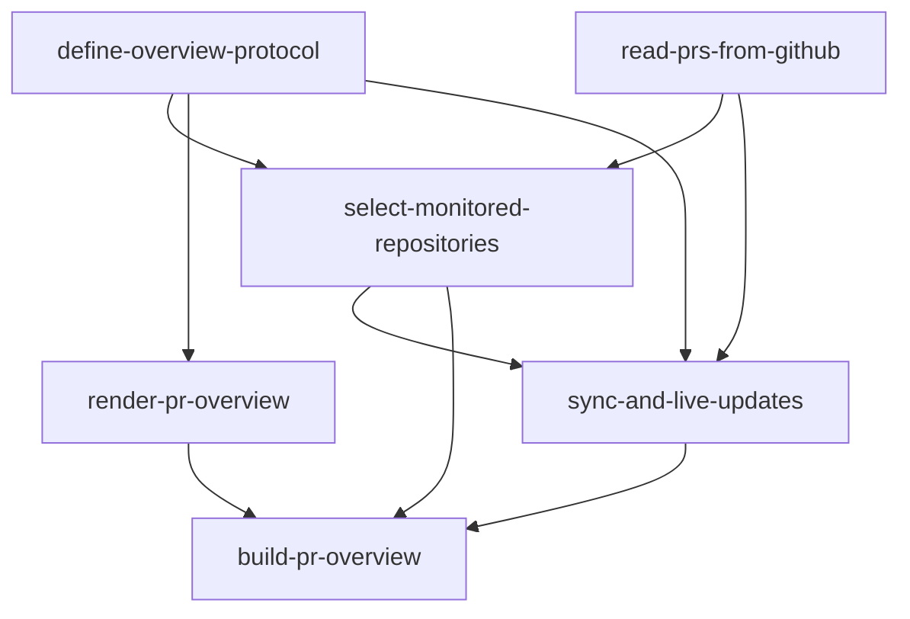

# PR overview: parallel work

The owner requested this split on 2026-10-17. The claimable work and its
acceptance gates live in [TODO.md](../TODO.md); this plan records how agents
share interfaces and avoid overlapping writes. It authorizes no deployment
or product work beyond the repository's existing scope.

## Dependencies

Start the protocol and GitHub reader independently. Once the protocol is
available, the page can proceed against its fixtures. Selection needs both
the protocol and the reader's installation-token helper. Sync then consumes
the completed reader and selection operations. The original slug remains
the final assembly and acceptance task, so downstream features still wait
for the complete overview.

Dependencies land before dependent work starts, or are explicitly stacked
as permitted by the [contract](../docket/CONTRACT.md). An agreed interface
does not by itself make blocked queue work ready. Each writer uses a
separate worktree, and each change receives independent review. Keep at
most two heavy builds or validation runs active; with four agent slots,
reserve capacity for review rather than starting four writers.

## Ownership and interfaces

| Task | Owned scope | Contract supplied to others |
| --- | --- | --- |
| `define-overview-protocol` | Overview migration, persistence codecs, shared wire types and fixtures, owner snapshot and hibernating socket route | JSON-safe repository and PR records, snapshot and message codecs, sync status, typed storage operations |
| `read-prs-from-github` | New GitHub transport modules and reader tests | Installation-token helper; PR count, full read and re-read operations; explicit partial/failure results, rate budget and repository visibility |
| `select-monitored-repositories` | Listing/selection modules, organization acceptance, Repositories component and tests | Refresh-one-installation operation; monitored repository set and owner overrides |
| `render-pr-overview` | Overview components, styling, socket client and browser tests | Page consuming the shared snapshot/messages, visibility reports and sync controls |
| `sync-and-live-updates` | Webhook mark reduction, scheduler/alarm, reconciliation and publication modules with runtime tests | Stored and pushed updates through the protocol and selection operations |
| `build-pr-overview` | Final integration fixes and recorded acceptance evidence | Demonstrated deliverable and locations of all acceptance evidence |

Protocol and reader authors agree the reader's return type before their
first implementations: repository/PR IDs, complete row data, unknown values,
pagination completeness and failure results, confirmed closed/merged PRs,
and review/check IDs and observed states for webhook fact retries. Missing
or inaccessible nodes must not be mistaken for confirmed closure. The reader
can start from the existing `PrInput`; it must not edit protocol-owned types
concurrently.
Protocol owns the boundary conversion for Map and non-finite times, rather
than passing unmodified rule inputs through JSON.

The protocol author also defines the selection refresh and mutation
interfaces. Repository selection owns their implementation; sync calls them
instead of reimplementing monitoring rules. The reader owns token minting
and caching; selection reuses it instead of creating another token cache.

Keep GitHub modules separate from the existing sign-in transport. Keep the
Repositories component separate from the overview page. Shared entrypoints
such as `src/object/instance.ts`, `src/worker/routes.ts`,
`src/worker/instance-stub.ts` and `src/frontend/App.tsx` need serialized
wiring commits coordinated between authors, or an explicitly stacked change.
Likewise, serialize any additional schema migrations, root configuration
changes and edits to `TODO.md`. Shared wiring receives independent review
and combined checks, just as the component implementations do.

## Acceptance ownership

The [deliverable](../docs/DELIVERABLE.md#acceptance-checks) stays authoritative.
Splitting work does not waive its checks.

| Check | Evidence owner |
| --- | --- |
| 1: owner-only sign-in | Existing `owner-sign-in` tests in PR #19; manual second-account scenario waived by the owner as recorded in TODO |
| 2: repository defaults, discovery and overrides | Selection demonstrates the rules; sync demonstrates delivery/sweep-triggered discovery |
| 3: exactly one correctly bucketed row | Existing `bucket-prs` rule tests in PR #18; sync demonstrates complete monitored PR ingestion |
| 4: row contents | Page |
| 5: notified changes within 60 seconds | Sync, with stubbed GitHub and runtime tests |
| 6: missed changes, catch-up and dormancy | Sync, including visibility input from the protocol |
| 7: last success and sync states | Page, including browser-clock, reconnect and visibility scenarios |
| 8: stale flag | Existing rule tests plus sync's mapping of GitHub activity and the page's badge |
| 9: free-tier operation without an LLM key | Final assembly |
| 10: phone readability and evidence wording | Recorded manual review during final assembly |

Final assembly exercises the real page, Worker, object and socket together;
fixture-only component tests do not prove that wiring. Use stubbed GitHub
for repeatable freshness/failure checks and record real-App scenarios
separately. A local App has no reachable webhook by default; tunnels and
deployment need the owner's authorization at the time. No billable resource
is provisioned by this planning change.
